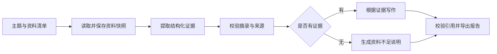

# SmartResearch-Agent

从一个研究主题和本地资料生成可追溯的 Markdown 报告。

**当前版本：v0.1.0，里程碑 ①，本地资料研究基线。** 当前采用固定工作流，为后续多智能体研究助手提供统一的资料、证据和报告格式。

验收主题：比较基础 RAG、混合检索和重排序方案，并给出可追溯的资料依据。

已经实现资料读取、证据提取、原文摘录校验、报告生成、引用关联校验和运行记录。
联网搜索、LangGraph 编排、FAISS 检索、CSV 分析、Streamlit 将在后续里程碑加入。

无需安装即可查看 [离线示例报告](examples/demo/report.md)、[证据记录](examples/demo/evidence.json)和[校验结果](examples/demo/validation.json)。示例包含三份中文学习笔记和六条原文摘录。

详细设计见[架构说明](docs/architecture.md)，后续验收目标见[开发路线](docs/roadmap.md)，开发命令见 [CONTRIBUTING.md](CONTRIBUTING.md)。

## 1. 运行第一个示例

需要 Python 3.9 或更高版本。在仓库根目录先安装环境，再运行示例：

~~~bash
python3 -m venv .venv
.venv/bin/python -m pip install --upgrade pip
.venv/bin/python -m pip install -r requirements-dev.lock.txt
.venv/bin/python -m pip install --no-build-isolation --no-deps -e .
.venv/bin/python -m smartresearch
~~~

默认使用 demo 模式，无需 API Key，不发送网络请求。输出大致如下：

~~~text
离线演示模式：规则摘录，不调用大模型。
1/4 读取本地资料
2/4 提取证据并校验原文摘录
3/4 根据有效证据组织报告
4/4 校验引用并保存报告
报告已生成
报告：…/runs/<本次运行编号>/report.md
运行记录：…/runs/<本次运行编号>/run.json
~~~

每次运行创建独立目录，已有报告不会被覆盖。

**demo 的含义：**固定摘录每份资料的前两个正文段落，用于检查输入、引用和输出流程；
它不会根据主题进行语义筛选，也不代表真实模型的研究能力。同样输入的报告内容可重复。

requirements-dev.lock.txt 记录本次验证的开发依赖版本，包含测试和格式工具。
本地验证使用 macOS arm64、Python 3.9.6；GitHub Actions 配置覆盖 Python 3.9、3.11、3.12。Windows 用户可将命令中的 `.venv/bin/python` 替换为 `.venv\Scripts\python.exe`。

## 2. 使用真实大模型

先复制配置模板，并在本地编辑 .env：

~~~bash
cp .env.example .env
~~~

填写 OPENAI_API_KEY 与 OPENAI_MODEL。模型 ID 使用你账户中可用、支持 Responses API
和 Structured Outputs 的模型。已有环境变量优先于 .env；命令行 --model 优先于 OPENAI_MODEL。
模型配置不写死在代码里。密钥和 runs 目录已加入 .gitignore。

~~~bash
.venv/bin/python -m smartresearch --provider openai
~~~

该模式会将指定资料的文本发送给 OpenAI，通常执行两次模型请求：提取证据、组织报告。
没有证据时跳过写作请求，直接输出资料不足。认证失败、配额限制、超时、拒绝回答、
无效结构或无效引用会明确报错，不会自动退回 demo。

API 实现使用 [OpenAI 官方 Structured Outputs 文档](https://developers.openai.com/api/docs/guides/structured-outputs)
中的 Responses + Pydantic 接口。
每次调用最多输出 6,000 tokens，超时设为 60 秒，SDK 自动重试关闭，响应 store=False。
没有配置 API Key 的环境只验证离线流程及模拟 HTTP 响应下的真实 SDK 集成，
不视为真实账户或真实模型质量验证。

## 3. 换成自己的研究资料

创建一个 JSON 清单，并把 UTF-8 编码的 .txt 或 .md 资料放在清单所在目录或其子目录。
下面是清单的最小内容，source.txt 是你准备的文本文件：

~~~json
{
  "sources": [
    {
      "id": "S1",
      "title": "资料标题",
      "path": "source.txt",
      "url": null,
      "note": "可填写作者、时间、原始来源或资料性质"
    }
  ]
}
~~~

id 必须唯一，格式为 S1、S2 等；url 可以省略，填写时需为完整 HTTP/HTTPS 地址。
程序不会访问 url；它是报告里的出处链接。每次接受 1–20 份资料，单文件上限 100 KB，
正文合计上限 60,000 字符。超过限制会报错，不会静默截断。

~~~bash
.venv/bin/python -m smartresearch \
  --provider openai \
  --topic "你的具体研究问题" \
  --sources /绝对路径/资料清单.json
~~~

examples 中的三份资料是根据官方文档编写的短篇中文学习笔记。
它们不是网站原文快照，也没有性能对照实验。程序中的摘录与行号对应本地笔记，
manifest 中保留其性质及参考网址。真实研究建议使用你核对过的原始资料。

参考资料：[LangChain 检索说明](https://docs.langchain.com/oss/python/deepagents/retrieval)、
[Elastic RRF](https://www.elastic.co/docs/reference/elasticsearch/rest-apis/reciprocal-rank-fusion)、
[Sentence Transformers 检索与重排序](https://www.sbert.net/examples/sentence_transformer/applications/retrieve_rerank/README.html)。

## 4. 理解代码和结果



```text
SmartResearch-Agent/
├── src/smartresearch/       # 命令行、数据结构、生成接口与工作流
├── examples/               # 本地资料和可直接阅读的演示输出
├── tests/                  # 离线流程及真实 SDK 的模拟 HTTP 测试
├── docs/                   # 架构说明与开发路线
├── scripts/build_demo.py   # 重建仓库中的演示输出
├── .github/workflows/      # 自动测试和演示一致性检查
├── .env.example            # 本地模型配置模板
└── pyproject.toml          # 依赖声明和命令行入口
```

| 模块 | 阅读时关注的问题 |
| --- | --- |
| src/smartresearch/cli.py | 参数和模型配置如何进入程序？ |
| src/smartresearch/sources.py、schemas.py | 如何统一资料、证据和报告的数据格式？ |
| src/smartresearch/providers.py | 如何替换生成方式、定义提示词、调用结构化输出？ |
| src/smartresearch/validation.py、report.py | 如何找到原文、拒绝错误引用并渲染报告？ |
| src/smartresearch/pipeline.py | 各阶段如何衔接、保存结果并定位失败？ |

每次运行保存以下产物：

| 文件 | 用途 |
| --- | --- |
| report.md、report.json | 阅读报告或继续用程序处理 |
| extraction.json、evidence.json | 查看提取结果、证据编号、摘录和行号 |
| sources.json、sources/*.txt | 资料元信息与 UTF-8 文本快照，SHA-256 对应快照内容 |
| validation.json | 引用与摘录校验结果 |
| run.json、events.jsonl | 运行模式、模型、状态、耗时、token 用量、阶段事件 |

**校验边界：**程序验证摘录确实出现在对应资料中，且每条报告结论引用的证据存在。
这不等于证明模型推论正确，也不验证外部网站内容与本地笔记一致。
semantic_support_verified 明确记录为 false；目前应人工对照证据审核结论，
尤其是数字、比较和因果判断。无相关证据时的“资料不足”分支由程序控制。

失败时 run.json 记录失败阶段与简明原因，已产生的资料快照和中间产物保留。
Token 统计只覆盖成功获得的 API usage，不是完整账单；失败请求也可能产生费用。
真实模型输出不承诺逐字重复，资料快照用于复查输入和证据。

## 5. 验证与开发顺序

~~~bash
.venv/bin/python -m pytest -q
.venv/bin/python -m ruff check src tests scripts
.venv/bin/python -m ruff format --check src tests scripts
~~~

目前有 **18 项测试**，覆盖完整离线流程、摘录与行号、快照哈希、错误来源、虚构摘录、无证据分支、
错误引用、非法输入和配置缺失。OpenAI 集成测试使用真实 SDK 与 HTTP MockTransport，
验证结构化请求、响应解析、用量记录，以及拒绝、未完成、认证失败等情况；不联网。

GitHub Actions 会执行测试、代码检查、命令行演示和样例一致性检查，远程结果以仓库 Actions 页面为准。仓库尚未完成真实账户的端到端模型质量评测，也未实现模型自主选择工具的循环。

后续按以下顺序扩展，每个阶段保留现有资料和证据格式：

1. 完成本地真实模型验收：复核一份模型报告中的结论与来源。
2. 加入自动搜索、网页正文提取和来源去重。
3. 加入 LangGraph 规划、共享状态及有次数上限的补搜。
4. 加入向量检索和可选 CSV 分析。
5. 加入 Streamlit、固定评测问题集和演示说明。
